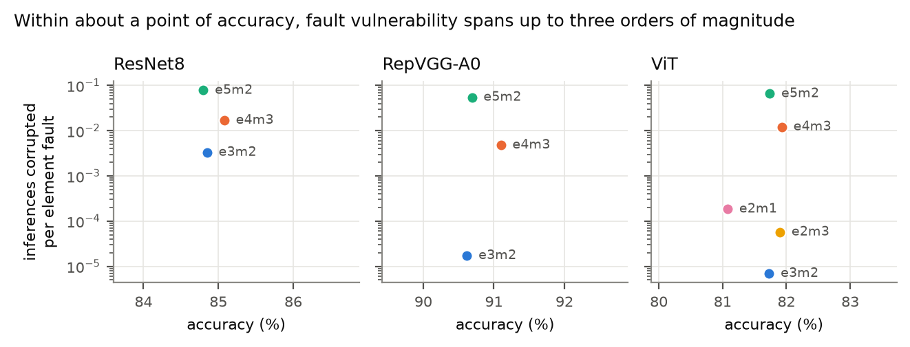
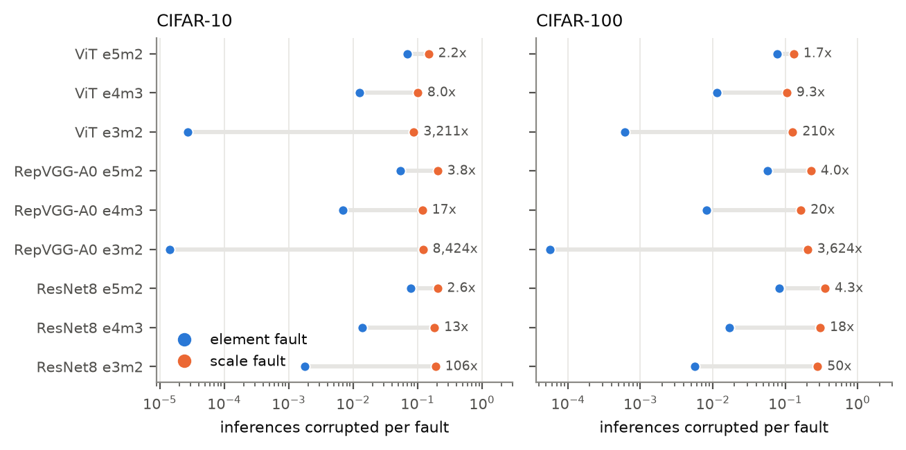
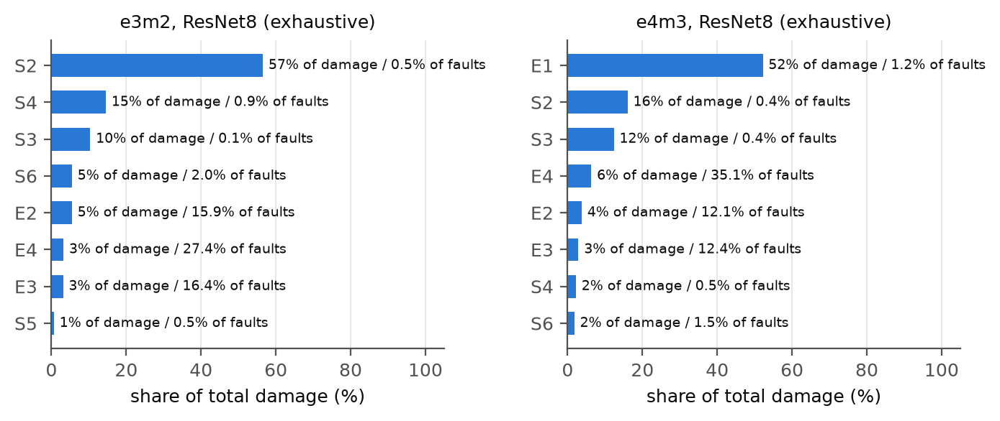
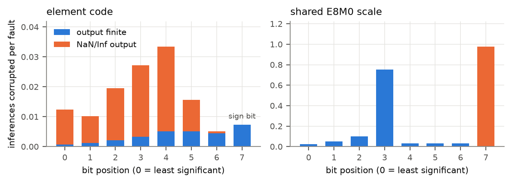
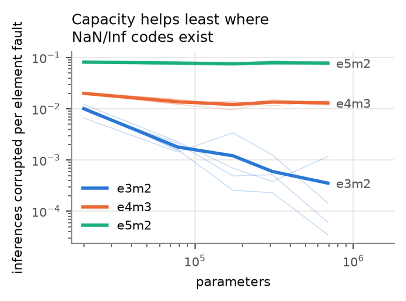
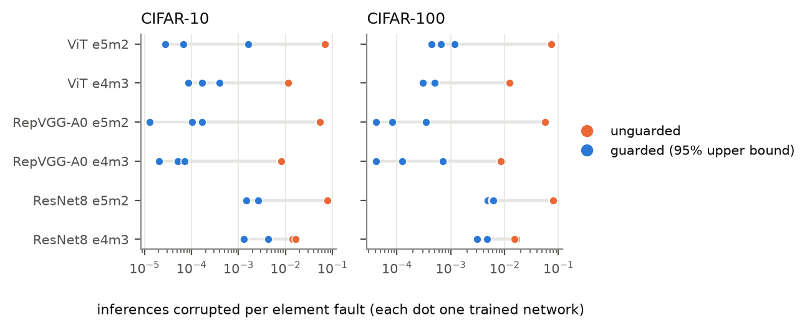
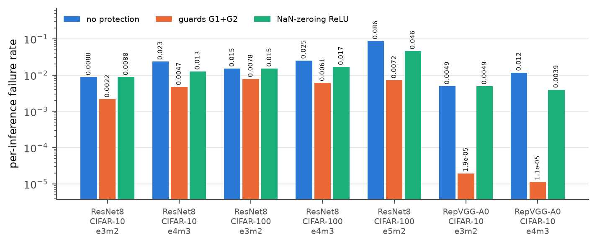

<div align="center">

# Reliability-Aware Fault Injection for Microscaling-Based DNNs

**What happens to a neural network when one bit flips inside an MX accelerator, and how to stop it**

[](https://www.python.org)
[](https://pytorch.org)
[](tests)
[](results)

**Peeyush Agarwal** (230749), Department of Aerospace Engineering, IIT Kanpur<br>
CS496 Undergraduate Project, supervised by **Prof. Urbi Chatterjee**

[**UGP report (PDF)**](docs/ugp_report/main.pdf) ·
[**Slides**](docs/ugp_report/UGP_Presentation.pptx) ·
[**Flip-case algorithm**](docs/flip_algorithm.md) ·
[**Experiment log**](docs/findings.md) ·
[**Cite**](#citation)

</div>

---

## At a glance

Microscaling (MX) formats let AI accelerators run networks with 4 to 8 bit numbers by giving
every block of 32 values one shared 8-bit scale. That shared scale is cheap, but it changes how
hardware faults behave. In ordinary floating point, a flipped bit damages one number. In MX,
the same flip can rescale all 32 numbers in a block at once.

This project measures what that means for real networks, explains it, and turns the explanation
into cheap protection.

| | |
|---|---|
| **2,000×** | On the vision Transformer, e5m2 and e3m2 have the same accuracy (81.74% vs 81.73%), yet one element fault in e5m2 is about 2,000 times as likely to corrupt a prediction. |
| **13× to >1000×** | How much more damaging a shared-scale fault is than an element fault. On ResNet8 one scale fault corrupts 49.9 of 200 predictions on average; one element fault corrupts 3.3. |
| **<2% → >50%** | Three of 22 flip cases (NaN/Inf codes and scale overflow) are under 2% of stored bits but cause more than half of all failures. Every one of them is a 0→1 flip. |
| **29× to 4100×** | Reduction in element damage on the larger models from read-time guards that need no extra memory. |
| **~1,000 vs 500,000** | Injections needed to recover the exact, exhaustive failure rate when the campaign is planned by flip case. |

The study covers **3 architectures** (ResNet8, RepVGG-A0, a vision Transformer), **2 datasets**
(CIFAR-10, CIFAR-100), **5 element formats**, **4 block sizes**, weights and activations, and
every bit and layer. In total that is more than **3 million injections** on over **60
independently trained networks**, including **2 exhaustive campaigns** (1.1 million injections)
that flip every stored bit of a ResNet8 and serve as exact ground truth.

---

## Contents

1. [Background: why MX changes the fault model](#1-background-why-mx-changes-the-fault-model)
2. [Objectives](#2-objectives)
3. [Methodology](#3-methodology)
4. [Results](#4-results)
5. [Design guidance](#5-design-guidance)
6. [Getting started](#6-getting-started)
7. [Reproducing the experiments](#7-reproducing-the-experiments)
8. [Repository layout](#8-repository-layout)
9. [Limitations and future work](#9-limitations-and-future-work)
10. [Citation](#citation)

---

## 1. Background: why MX changes the fault model

An MX tensor is stored in blocks of K values (K = 32 by default). Each value keeps a narrow
element code, and the whole block shares one E8M0 scale, an 8-bit power of two with bias 127:

```
v[i] = decode(code[i]) × 2^(X − 127)
```

### Element formats

| format | family | sign / exp / mantissa | largest value | NaN / Inf codes |
|---|---|:---:|---:|---|
| e4m3 | MXFP8 | 1 / 4 / 3 | 448 | 2 (NaN) |
| e5m2 | MXFP8 | 1 / 5 / 2 | 57,344 | 8 (2 Inf, 6 NaN) |
| e3m2 | MXFP6 | 1 / 3 / 2 | 28 | none |
| e2m3 | MXFP6 | 1 / 2 / 3 | 7.5 | none |
| e2m1 | MXFP4 | 1 / 2 / 1 | 6 | none |

The last column matters a lot. Only the 8-bit formats have codes that decode to NaN or
infinity, and most of the differences between formats below trace back to it.

### Two fault sites

| site | width | effect of one flipped bit | blast radius |
|---|---|---|---|
| element code | 4 to 8 bits | one value changes; in e4m3 and e5m2 it can become NaN or Inf | 1 value |
| shared scale | 8 bits | every value in the block is multiplied by 2^(±2^j) for scale bit j | K values |

A worked example: a typical scale byte is X = 118 = `0111 0110`. Bit 7 is 0. Flipping it gives
X' = 246, so the exponent jumps by +128 and every value in the block is multiplied by
2^128, which is past the float32 range. The block is lost, and usually the prediction with it.

The scale is only about 3% of storage (8 bits out of 8 + 32 × 8 for e4m3 at K = 32), but it
reaches every value in its block. Earlier fault-injection work assumed one flip damages one
number. Under MX that assumption breaks, and this had not been measured.

---

## 2. Objectives

| | objective | answered in |
|---|---|---|
| **O1** | How do faults in shared scales differ from faults in elements, and how do both propagate? | [4.2](#42-shared-scales-dominate), [4.3](#43-the-flip-case-algorithm-names-the-dangerous-bits) |
| **O2** | Does reliability differ across MX formats at comparable accuracy? | [4.1](#41-equal-accuracy-does-not-mean-equal-reliability) |
| **O3** | How does block size trade efficiency against reliability? | [4.4](#44-block-size-tensor-type-and-fault-location) |
| **O4** | Which tensors (weights, activations), bits and layers are most vulnerable? | [4.4](#44-block-size-tensor-type-and-fault-location) |
| **O5** | Which properties of a representation make a model vulnerable, and can they be guarded? | [4.5](#45-what-makes-a-model-vulnerable-and-how-to-guard-it) |

---

## 3. Methodology

The methodology has two parts: an injector that is faithful to the hardware, and an algorithm
that explains what each fault does.

### 3.1 `mxfi`, a bit-accurate fault injector

- **Real bits, not noise.** Each tensor is encoded into actual MX bit patterns. Scales and
  element codes are separate, addressable arrays, and a fault is an XOR of one bit into
  either site, applied *before* decoding. This is the only way to see a scale fault hit 32
  values or an element flip land on a NaN code.
- **Deployment form.** Networks are injected as they would run on hardware: batch norm folded,
  RepVGG branches fused, weights blocked along the reduction axis.
- **Faithful NaN handling.** NaN propagates through re-quantisation as the OCP conversion rules
  specify.
- **Exact impact tables.** Each element alphabet has at most 256 codes, so the decoded effect of
  every (code, bit) flip is known exactly and can be enumerated without injecting.
- **Provenance.** Every campaign is tied to the checkpoint that produced it by replaying
  recorded faults (`tools/verify_ground_truth.py`).

### 3.2 Fault model and metric

One bit in one stored value is flipped. A weight fault persists for every input; an activation
fault affects one inference. Each fault is scored on a fixed, class-balanced set of **200 test
images** against the fault-free quantised network.

The metric is the **per-inference failure rate**: the probability that one fault changes one
prediction. The common "did any of the 200 predictions change" metric saturates and mostly
measures whether the evaluation set happens to contain a near-tie input, so it is not used for
comparisons (see [4.7](#47-methodological-findings)).

### 3.3 The flip-case algorithm

A fault becomes a wrong answer only if it survives five stages:

```
 stage 0           stage 1              stage 2             stage 3             stage 4
 fault model   →   encoding         →   read-time checks →  datapath        →   decision
 the bit really    the stored number    nothing notices      the computation     the top-1
 flips             changes (22 cases)   (D1, D2, D3)         carries the error   prediction moves
```

Stage 1 is the core. Every possible single-bit flip falls into **exactly one of 22 cases**:

| scale case | condition | effect | element case | condition | effect |
|---|---|---|---|---|---|
| S0 | all elements are ±0 | masked | E0 | sign of ±0 | masked |
| **S1** † | X' = 255 | block becomes 32 NaNs | **E1** † | into a NaN/Inf code | NaN or ±∞ |
| **S2** † | Δ = +128 | ±∞ or huge | E2 | sign bit | v → −v |
| S3 | Δ ≥ +8 | ×256 or more | E3, E3a, E3b | exponent 0→1 | value grows |
| S4 | Δ ∈ {1, 2, 4} | ×2 to ×16 | E4, E4a, E4b | exponent 1→0 | value shrinks |
| S5 | Δ ∈ {−1, −2} | ÷2, ÷4 | E5, E5a | mantissa 0→1 | small growth |
| S6 | Δ ≤ −4 | ÷16 or more | E6, E6a | mantissa 1→0 | small shrink |
| S7 | X = 255 already | only after a prior fault | E7 | code already special | only after a prior fault |

† catastrophic. Two properties were proved and then checked by brute force against the
exhaustive campaigns:

1. **Completeness.** The 22 cases cover every possible flip, for every format.
2. **Direction.** Every catastrophic flip is a **0→1** flip. NaN, Inf and overflow codes are
   all-ones patterns, so they can only be reached by setting a zero bit.

Because a clean MX tensor never contains a NaN element code or a wildly out-of-range scale, both
can be checked when a value is read. That gives two guards that cost no memory:

- **G1**: an element holding a NaN/Inf code is read as zero.
- **G2**: a scale far above the tensor's normal range zeroes its block.

The case of every bit is also known *before* any injection, which turns the algorithm into a
sampling plan: inject a few faults per case and weight each case by its exact size (E29).

Full write-up: [`docs/flip_algorithm.md`](docs/flip_algorithm.md) · Code:
[`mxfi/cases.py`](mxfi/cases.py)

### 3.4 Experimental setup

| network | type | parameters | CIFAR-10 | CIFAR-100 |
|---|---|---:|---|---|
| ResNet8 (MLPerf Tiny) | CNN | 78K | 87.0% | 58% (3 seeds) |
| ResNet8 width sweep (8 to 48) | CNN | 20K to 692K | 10 networks per width | – |
| RepVGG-A0, fused | re-parameterised CNN | 7.0M | 91.4–91.5% (3 seeds) | 70–71% (3 seeds) |
| ViT, DeiT-Tiny width, depth 6 | Transformer | 2.7M | 80.4–81.9% (3 seeds) | 47–49% (3 seeds) |

Most campaigns draw 3,000 faults uniformly over all stored bits. The exhaustive ResNet8
campaigns (483,904 faults for e3m2 and 638,624 for e4m3) validate them: a 3,000-fault campaign
lands within 2.4% of the exact rate.

---

## 4. Results

### 4.1 Equal accuracy does not mean equal reliability



Element-fault rate per inference (CIFAR-10, K = 32):

| network | trained networks | e3m2 | e4m3 | e5m2 |
|---|:---:|---:|---:|---:|
| RepVGG-A0 | 3 | 0.00001 | 0.00688 | 0.05381 |
| ViT | 3 | 0.00003 | 0.01258 | 0.06897 |
| ResNet8 | 1 | 0.00332 | 0.01699 | 0.07801 |
| ResNet8, width 8 | 5 | 0.01003 | 0.02005 | 0.08143 |
| ResNet8, width 16 | 5 | 0.00180 | 0.01374 | 0.07831 |
| ResNet8, width 48 | 4 | 0.00035 | 0.01302 | 0.07812 |

The ordering **e3m2 < e4m3 < e5m2** holds on every network and both datasets. Within about one
point of accuracy, vulnerability spans more than two orders of magnitude on ResNet8 and nearly
four on RepVGG-A0 and the ViT. A 6-bit format can be far more reliable than an 8-bit one, and
choosing a format by accuracy or bit width alone would never show it.

### 4.2 Shared scales dominate



On every network, format and dataset, a scale fault is worse than an element fault, typically by
13× to more than 1000×. In the exhaustive e3m2 campaign the scales are 4.1% of storage and carry
87.6% of all damage. Flips that grow a block are catastrophic; flips that shrink it are mild.

### 4.3 The flip-case algorithm names the dangerous bits



Joining all 1.1 million exhaustive faults with their cases:

- In **e3m2**, case **S2** (scale overflow) is **0.5%** of faults and **57%** of damage.
- In **e4m3**, case **E1** (flip into NaN) is **1.2%** of faults and **52%** of damage.
- The ordinary flips (E2 to E6), which are most of all faults, cause only about a tenth.
- **0→1 flips carry 87.5–88.7% of all damage.** A memory whose faults are mostly 1→0 (for
  example, charge loss) would see 7 to 8 times fewer failures than the usual symmetric model
  predicts.

### 4.4 Block size, tensor type and fault location

**Block size is a trade-off, not a free win.** Larger blocks make scale faults rarer but worse:

| (ResNet8, e4m3) | K = 8 | K = 16 | K = 32 | K = 64 |
|---|---:|---:|---:|---:|
| scale bits, share of storage | 11.1% | 5.9% | 3.1% | 1.7% |
| scale fault, inferences corrupted (of 200) | 40.1 | 45.3 | 48.7 | 50.1 |
| element fault, per-inference rate | 0.0241 | 0.0208 | 0.0159 | 0.0136 |

**Weights and activations are about equally harmful per fault** (a weight fault does 0.6–2.2×
the damage of an activation fault). The real difference is lifetime: a corrupted weight stays
wrong for every input, a corrupted activation is gone after one inference.



**Which bit.** On the element side, most damage comes from flips into the NaN pattern: in e4m3
the 1.27% of element faults that do this carry 77.6% of element damage. On the scale side, bits
3 and 7 stand out. They are normally 0, so flipping them multiplies the block by 256 (75% of
inferences corrupted) or overflows it (98%). Flipping bits 4 to 6, which are normally 1, only
shrinks the block (3%).

**Which layer.** The most fragile layer is the smallest one, the stem convolution. A uniform
campaign mostly samples the large, robust layers and under-represents it.

### 4.5 What makes a model vulnerable, and how to guard it



1. **Special codes.** On the larger models, flips into NaN/Inf codes are under 8% of element
   faults but carry 97 to 100% of element damage. The NaN-free formats have no such failure.
2. **Capacity absorbs small errors, not NaN.** Across a 35× range of ResNet8 widths, capacity
   improves e3m2 (no special codes) 25×, e4m3 (two codes) 1.5×, and e5m2 (eight codes) not at
   all.
3. **The rest follows the network's margin-normalised sensitivity**, not the format's mantissa
   or exponent width.

**Guards.** On the exhaustive ResNet8 campaigns, the read-time checks flag 85.8% (e3m2) and
84.5% (e4m3) of all damage.
G1 + G2 cut the ResNet8 failure rate 4.3× (e3m2) and 5.2× (e4m3), and G1 alone cuts element
damage by 29× to 4100× on RepVGG-A0 and the ViT.



### 4.6 Case-guided campaigns (E29) and CIFAR-100

E29 plans each campaign by flip case (60 faults per case on ResNet8, 25 on RepVGG-A0) and scores
every fault with no protection, with G1 + G2, and with a NaN-zeroing ReLU.

| network | fmt | fault space | injected | rate ± SE | variance reduction | catastrophic share (faults / damage) | G1 + G2 |
|---|---|---:|---:|---|---:|---|---:|
| ResNet8, C-10 | e3m2 | 483,904 | 1,020 | 0.00880 ± 0.00038 | 41× | 0.5% / 57% | 4.1× |
| ResNet8, C-10 | e4m3 | 638,624 | 881 | 0.02347 ± 0.00043 | 108× | 1.6% / 69% | 5.0× |
| ResNet8, C-100 | e3m2 | 519,904 | 1,020 | 0.0152 ± 0.0008 | 11× | 0.5% / 33% | 1.9× |
| ResNet8, C-100 | e4m3 | 686,144 | 862 | 0.0251 ± 0.0005 | 75× | 1.6% / 63% | 4.1× |
| ResNet8, C-100 | e5m2 | 686,144 | 724 | 0.0863 ± 0.0007 | 199× | 7.6% / 88% | 12× |
| RepVGG-A0, C-10 | e3m2 | 43,980,128 | 425 | 0.00494 ± 0.00021 | 210×* | 0.5% / 88% | 258×* |
| RepVGG-A0, C-10 | e4m3 | 58,053,504 | 450 | 0.01165 ± 0.00018 | 724×* | 1.2% / 95% | 1030×* |

\* No injected ordinary fault changed a prediction, so these figures are optimistic.



- **Cheap and accurate.** About 1,000 injections recover the exhaustive ResNet8 rate within 0.2
  standard errors (0.00880 vs 0.00878; 0.02347 vs 0.02356), against 484 to 639 thousand for the
  exhaustive campaign.
- **The predictions carry over.** Every catastrophic fault was 0→1 in all seven runs.
- **Catastrophic can be silent.** On RepVGG-A0 e3m2, S2 flips corrupt 87% of predictions but
  only 8% produce a NaN output, so an output NaN check would miss most of them. The scale check
  catches all of them.
- **CIFAR-100.** Every headline result replicates on the harder task. The format gap narrows
  (on the Transformer, e4m3/e3m2 falls from 461× to 19×), but its direction never changes.

### 4.7 Methodological findings

- The "any image changed" SDC metric is confounded by near-tie inputs in the evaluation set. One
  fault list replayed on nine evaluation sets made e3m2 and e4m3 look equal and swap order; per
  inference they differ 5.6× and 7.6×, stable across sets. Conclusions drawn from the old
  metric early in the project were withdrawn.
- Stratifying on exact per-code enumeration reduces variance 57× to 120× against uniform
  sampling.
- Double-bit faults (390,000 injections) do 1.04–1.55× the damage of a single flip and change no
  conclusion, so single-bit injection is sufficient.

---

## 5. Design guidance

For MX accelerator designers:

1. **Protect the shared scale first.** Parity or ECC on scale bytes is the cheapest protection
   with the largest payoff. If only some scale bits can be protected, protect the ones normally
   at 0.
2. **Avoid NaN/Inf element codes, or guard them.** Prefer formats without special codes, or add
   G1 and G2 at read time. They cost a comparison and no memory.
3. **Do not use accuracy or bit width as a proxy for reliability.**
4. **Treat block size as a trade-off.** With protected scales, large blocks are safe.
5. **Allocate protection by vulnerability, not storage.** Watch 0→1 flips and the small early
   layers.

For fault-injection campaigns on MX models: report the per-inference rate, replicate over
several independently trained networks, inject single-bit faults, and stratify by flip case.

---

## 6. Getting started

Requires Python 3.11 or later.

```bash
git clone https://github.com/peeyushagarwal2004/CS496_UGP.git
cd CS496_UGP
python -m venv .venv
.venv/Scripts/python -m pip install -r requirements.txt --extra-index-url https://download.pytorch.org/whl/cpu
.venv/Scripts/python -m pytest tests -q
```

On Linux or macOS use `.venv/bin/python`. For GPU runs, install a CUDA build of PyTorch instead
of the CPU wheel. CIFAR-10 and CIFAR-100 are downloaded into `data/` by torchvision on first use.

### Using the library

The core of `mxfi` works on plain numpy arrays and has no PyTorch dependency:

```python
import numpy as np
from mxfi import quantize, Fault, inject
from mxfi.cases import classify_elements, label

x = np.random.randn(4, 128).astype(np.float32)
q = quantize(x, "e4m3", block_size=32)          # codes (4, 4, 32), scales (4, 4)

inject(q, Fault("element", (0, 0, 0), 7)).decode()   # changes 1 value
inject(q, Fault("scale",   (0, 0),    7)).decode()   # changes all 32 values of the block

# which flip case would a fault be?
idx = tuple(np.zeros(1, dtype=int) for _ in range(q.codes.ndim))
case = classify_elements(q, idx, np.array([3]))["case"][0]
print(label(case))                                    # e.g. "E4"
```

The PyTorch wrapper (`mxfi.torch_mx`) quantises a whole network and injects single- and
multi-bit faults into its weights or activations.

---

## 7. Reproducing the experiments

All commands run from the repository root with `PYTHONPATH=.`. Each experiment's docstring says
what it tests and how to run it.

```bash
python -m mxfi.train --model resnet8 --epochs 60                       # train a network
python -m experiments.e01_uniform_baseline --model resnet8 --fmt e4m3  # 3,000-fault campaign
python -m experiments.e29_case_guided --run resnet8_e3m2              # case-guided campaign
```

A model name ending in `_c100` (for example `vit_small_c100`) uses CIFAR-100. Add
`--device cuda` to run on a GPU.

| experiments | question | objective |
|---|---|---|
| `e00`, `e01`, `e02`, `e06` | quantised accuracy, format campaigns, stratified sampling, exhaustive ground truth | O2, validation |
| `e03`, `e03b` | block size under the OCP and a non-clipping scale rule | O3 |
| `e04` | activation faults on all networks | O4 |
| `e08`–`e11`, `e14`, `e16` | why equal-width formats differ: geometry, perturbation size, margins, sensitivity | O5 |
| `e12`, `e15`, `e17`–`e20`, `e22` | metrics, severity, value-aware sampling, evaluation-set effects | method |
| `e05c` | near-tie inputs and the any-image metric | method |
| `e21` | single-bit against multi-bit faults | method |
| `e23` | read-side NaN guard | O5 |
| `e24` | every headline result on CIFAR-100 | all |
| `e25`–`e28` | flip-case algorithm against the exhaustive campaigns, datapaths, activation cases | O1, O5 |
| `e29` | case-guided campaigns and guards on three networks | O1, O5 |
| `width_sweep_*` | model capacity across ResNet8 widths | O5 |

Figures and reports:

```bash
python -m experiments.make_figures          # docs/figures
python -m experiments.make_report_figures
python -m experiments.make_ugp_figures      # docs/ugp_report/fig
cd docs/ugp_report && pdflatex main.tex && pdflatex main.tex
```

---

## 8. Repository layout

```
mxfi/                 the library
  formats.py            exact element alphabets and the E8M0 scale
  codec.py              MX encode/decode, OCP and non-clipping scale rules
  faults.py             two-site fault model, exact impact tables
  cases.py              the flip-case algorithm (22 cases, read-time checks)
  torch_mx.py           PyTorch wrapper with fast single- and multi-bit injection
  sampling.py           uniform and stratified fault sampling
  stats.py              Wilson intervals, stratified estimators
  campaign.py           golden-versus-faulty campaign driver
  models.py, vit.py     ResNet8, RepVGG-A0, ViT
  data.py, train.py     CIFAR loaders and training
experiments/          one script per experiment (e00 to e29) and the figure scripts
tests/                252 unit tests
tools/                GPU support and checkpoint/campaign verification
scripts/              batch runners for the long CPU campaigns
results/              raw campaign outputs from the laptop runs
checkpoints/          networks trained on the laptop, with per-epoch logs
cluster/              networks, results and runners from the IITK GPU server
docs/
  ugp_report/           the UGP report (main.pdf) and presentation
  flip_algorithm.*      the flip-case algorithm in full
  findings.md           the experiment log, finding by finding
  report.pdf            the earlier technical report
  figures/              every figure, as PDF and PNG
```

**Why `cluster/` is separate.** Training is not bit-reproducible across machines, and the laptop
and the GPU server each trained networks under the same file names. A campaign is only valid
against the checkpoint in its own tree, so the two are kept apart. See
[`cluster/README.md`](cluster/README.md).

---

## 9. Limitations and future work

- **ImageNet and pretrained Transformers.** ImageNet was not reachable from the compute used, so
  a ViT at DeiT-Tiny width trained on CIFAR stands in for DeiT on ImageNet. The narrowing gap on
  CIFAR-100 suggests absolute gaps may be smaller at ImageNet scale; the directions of the
  effects are the more transferable result.
- **Fault model.** Only stored values (weights, activations and their scales) are faulted.
  Accumulators, partial sums, normalisation and control logic are not.
- **Hardware.** The guards were simulated in software and should be validated on an FPGA or an
  accelerator model.
- **Scale.** The largest network has 7 million parameters; large language models and MXINT8 were
  not studied.

---

## Citation

```bibtex
@misc{agarwal2026mxfi,
  author       = {Peeyush Agarwal},
  title        = {Reliability-Aware Fault Injection for Microscaling-Based {DNNs}},
  year         = {2026},
  howpublished = {CS496 Undergraduate Project, Indian Institute of Technology Kanpur},
  url          = {https://github.com/peeyushagarwal2004/CS496_UGP}
}
```

## Acknowledgements

I thank my supervisor, Prof. Urbi Chatterjee, for the problem statement and guidance throughout
this project, Vishesh Mishra for help along the way, and IIT Kanpur for access to its GPU
server.
